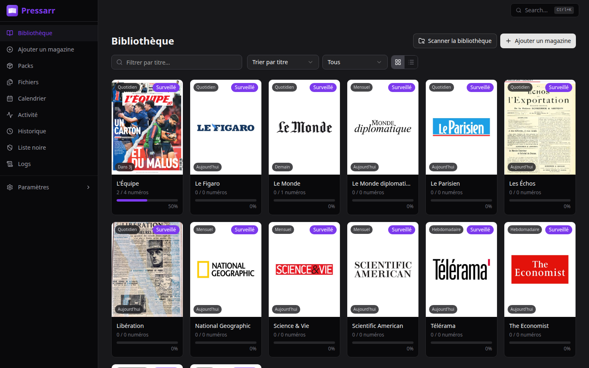
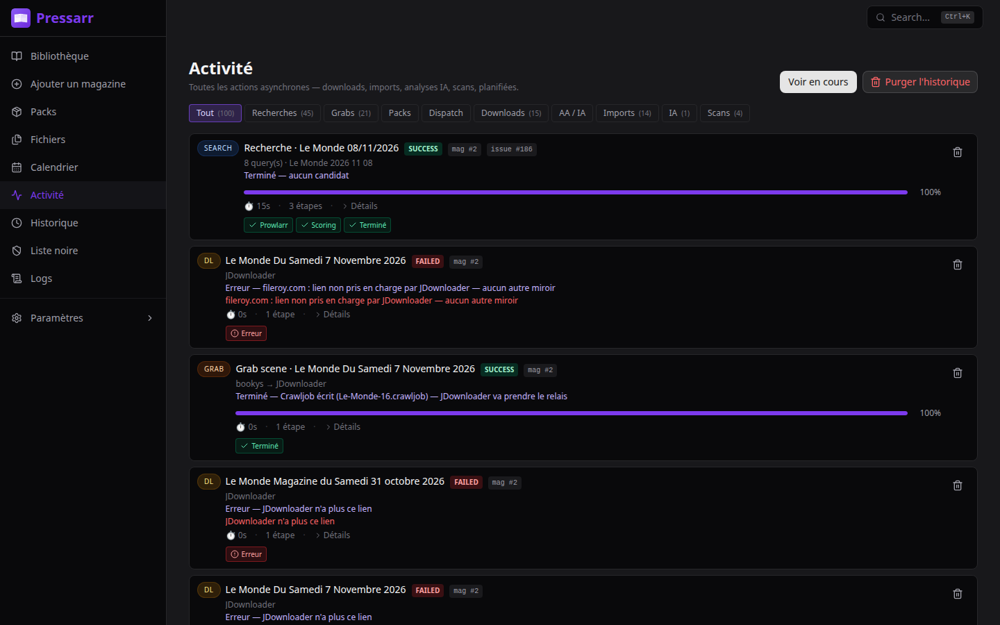
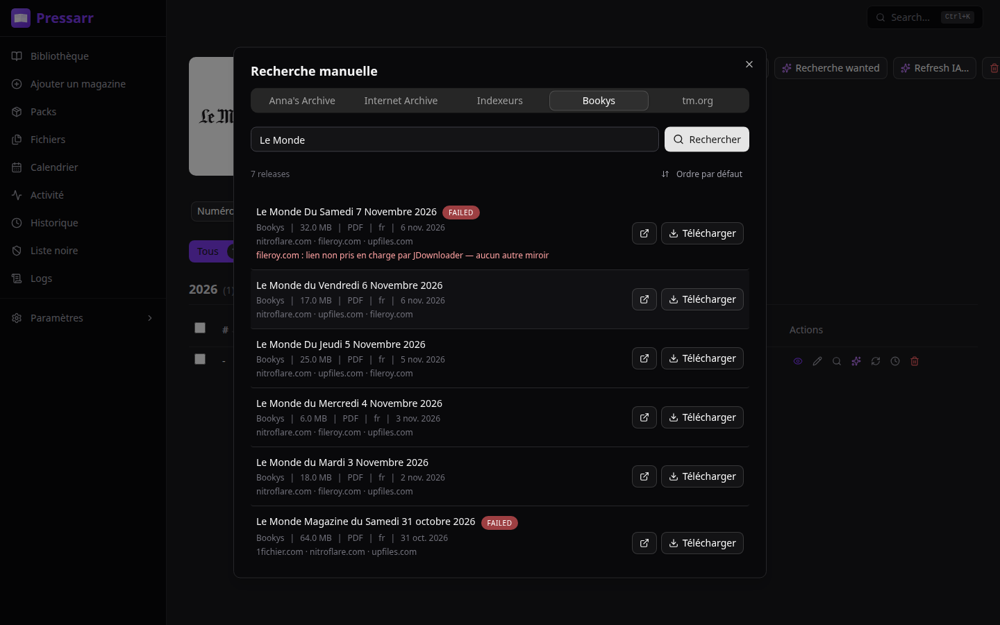

# GitHub Releases - Pressarr

> Release notes for GitHub releases. The first `# vX.Y.Z` block is
> consumed by the release CI as the description posted to GitLab and
> GitHub. Edit this file BEFORE running `npm run release:full`.

---

# v0.2.0

## 🤖 AI-assisted import, wanted-issue search, live Activity

Pressarr now searches your **wanted issues on its own**, checks that a
downloaded file really is the issue it was meant for before importing it,
and shows **every search, grab, download, import and AI run live** on a
new Activity page. An optional local **AI (Ollama)** reads release names
and covers when the filename is not enough.



> [!IMPORTANT]
> Two features are **experimental** and off by default:
> - **AI (Ollama)** — working, but its settings and behaviour may still change.
> - **Bookys + JDownloader** — **not validated**. Searching works, but the
>   free hoster mirrors ask for a captcha or have no JDownloader plugin, so
>   most downloads fail without a premium or debrid account in JDownloader.

---

### 🔍 Wanted-issue search

- Wanted issues are searched on a schedule (every 4 h by default, configurable), and right away when you add a magazine.
- Several queries per issue: number (`N°`, `#`) and date formats.
- Results must match the title (threshold global or per magazine) and the issue's date before they are scored.
- **Auto-grab** of the best result above a threshold — off by default.
- *Search wanted now* button per magazine, and the full pipeline detail per issue.

### 📂 Safer imports

- A file whose title or date does not match the target issue is refused and blocklisted instead of filed in the wrong place.
- A file is routed to the issue it really is (by date), even when another issue was searched.
- Parser: `DD-MM-YYYY` dates, French and English ordinals (*1er*, *27th*).
- **Issue groups** (weekend editions, specials) and a date tolerance per magazine.
- **Technical sheet** per issue: where the file came from and every step from the search to the import.

### 📊 Activity

- New **Activity** page with a sidebar badge: searches, grabs, downloads (with progress), imports, AI runs, packs and scans, each with its steps.
- Kept in its own database, so a busy queue never blocks the library.
- A JDownloader download followed when Pressarr restarts carries on in the same entry.



### 📦 Packs

- Grab a multi-issue pack: each file is extracted, analysed and dispatched to its magazine and issue.
- Review screen: edit the match, re-analyse, re-import or ignore a file.

### 🤖 AI with Ollama *(experimental)*

- **Metadata enrichment**: a text model reads the release name, a vision model and Python OCR read chosen zones of the cover; an arbiter merges both with the parser's result.
- Cover zones are set per magazine and per issue type with a visual editor.
- **Release ranker**: advises, vetoes the top result, or decides (`ai_advisory`, `ai_veto_only`, `ai_wins`).
- Every run is kept in History with its steps (and optionally the cover crops it read).

### 🏴 Scene indexers & JDownloader *(experimental, not validated)*

- **Bookys** rewritten for its new site: no account needed anymore, everything goes through FlareSolverr.
- The manual search **Bookys** tab looks like the indexer results: sortable, with date, size and mirrors, and a free query to add a date.
- The add-magazine search also lists titles found on Bookys.
- **Every JDownloader grab is followed like a torrent** (needs JDownloader's local API): progress in Activity, next mirror when one is offline, needs a captcha or is not supported, then import with the AI analysis.



### 🐳 Docker

- **`PUID` / `PGID` / `UMASK`**: Pressarr takes `/config` over for that user and runs as that user. Without them, nothing changes (root).
- The healthcheck runs in Python (the image has no `curl`).
- PyTorch (for EasyOCR) is the CPU build: the image is about 2 GB instead of 6 GB.
- The OCR engines (EasyOCR, RapidOCR) load in the image — they failed on a missing X11 library.

### 🎨 Interface

- Interface language in **Settings → General**.
- A magazine added from the search keeps the cover shown in the results (logos become readable covers).
- Library header fits on mobile; sortable issue columns; Bookys and AI flagged **Experimental** in Settings.

### 🐛 Fixes

- **Manual grab fails for magnet-only results (The Pirate Bay via Prowlarr)** — the magnet is used when there is no download link.
- **Healthcheck always unhealthy** — the check no longer needs `curl`.
- **Scene indexer enabled without JDownloader made every grab fail** — releases stay grabbable, and the scene auto-grab waits until JDownloader is on.
- **README mentioned a language setting that did not exist** — the setting is in Settings → General.
- **No PUID/PGID support** — supported.
- **Bookys login always fails** — Bookys no longer needs a login.
- **"Delete files" did not delete the files** — the files and the magazine's folder are deleted.
- **Add-magazine search lost sources or failed with a 500** — every source is kept and named.
- **Blocklist page empty** — entries show again.
- **History tab failed with a 500 on some titles** — fixed.
- **Durations kept growing on finished activities** — a finished activity shows how long it took.

---

### ⚠️ Upgrading

- Back up `/config` first. New tables and columns are created at start; activities go to a new `pressarr-activity.db` next to `pressarr.db`.
- Bookys' username and password are no longer used.
- AI needs an [Ollama](https://ollama.com) server; the scene indexers need FlareSolverr and JDownloader 2 — see the [README](https://github.com/sharkhunterr/pressarr#-service-setup).

### 🔗 Links

- [🐳 Docker Hub](https://hub.docker.com/r/sharkhunterr/pressarr)
- [📖 Documentation](https://github.com/sharkhunterr/pressarr#readme)
- [🐛 Report Issues](https://github.com/sharkhunterr/pressarr/issues)

---

# v0.1.51

## 📚 Magazine pipeline — ISSN cascade + scene grab + JDownloader 2

Full end-to-end magazine acquisition path : **discover** via an
ISSN-first metadata cascade, **grab** from scene indexers with a
Cloudflare-aware scraper, **download** through JDownloader 2, and
**import** back into your library — all automated with a
subscription vs one-shot flow.

> [!IMPORTANT]
> This release adds a new **FlareSolverr** dependency and expects a
> **JDownloader 2** container reachable from Pressarr. See
> `docker-compose` snippet below. Existing magazines are back-filled
> with the cascade at boot on first run; no migration needed but
> reserve a couple of minutes for the enrichment sweep.

---

### 🔎 ISSN-first metadata cascade

Metadata now flows through a proper cascade instead of a single
provider :

- **ZDB** (Zeitschriftendatenbank) — German serials authority.
- **Wikidata** — logos (P154 prioritised over P18), frequency
  (P2241 / P31), related publications, first-issued / ceased dates.
- **BnF** — French press authority via MARC 326 frequency field.
- **ISSN Portal** — canonical ISSN-L propagation.
- **Cross-reference** hits across providers via Wikidata identity
  with soft timeouts so a slow provider can't stall the cascade.

Every source is orchestrated with a **rank-first + canonical boost**
so real magazines rise above IA catalogue noise, and results without
an ISSN are dropped below verified ones. Multi-ISSN sibling lists
(print + online + CD-ROM) surface on the identity payload.

**Auto back-fill** : the cascade runs on every `POST /magazine` and
on boot for existing rows, so nothing has to be re-added by hand.

### 🎯 Scene indexers with Cloudflare bypass

Two new scrapers ship with proper release tables :

- **Bookys** — FlareSolverr-backed for Cloudflare bypass.
- **telecharger-magazines.org** — rewritten for the WordPress +
  liens-direct flow, with a friendlier error message when Cloudflare
  reports an origin outage.

Every scene grab produces a normalized release row (magazine +
issue + edition) and a full **history event** so you can audit what
was grabbed, when, and by which flow (manual / auto / RSS).

### ⏰ Auto-grab scheduler

- **Subscription vs one-shot** request type on the Magazine model.
- Subscription runs a periodic scan honouring your indexer set and
  quality profile ; one-shot fires once and stops.
- **Immediate back-catalogue grab** on add : when you subscribe to
  a title, Pressarr immediately searches the last N issues instead
  of waiting for the next scheduled tick.

### 🖥️ JDownloader 2 integration

Pressarr can now drive **JDownloader 2** directly for hosters that
need `.crawljob` file drops :

- **Dispatcher** writes one hoster URL per `.crawljob` (not all
  mirrors) so JD2 doesn't reject the payload.
- **downloadFolder** is the JD2-side path (container view), not
  Pressarr's — the folder-watch works out-of-the-box.
- **Booleans lowercased** in `.crawljob` and the hoster priority
  list demotes `frdl.io`.
- **Queue UI** — inspect + manage the JD2 queue directly from
  Pressarr : cancel, retry, prioritise.

### 📥 Scene importer

- Watches JD2's output folder → moves files into the library with
  the correct rename template.
- Flips the release status (`grabbed` → `imported`).
- Emits history events at every step (scene grab / auto-grab /
  import) so the timeline in the UI matches reality.

### 🎨 UI

- **MagazinePipelineSection** on the Magazine detail page shows the
  full grab / download / import status with a **Re-grab button**
  when the scene release is already present.
- **Queue page** merged all sources into a single list with
  **source badges** (no more tabs).
- **Settings → Indexers** absorbed the scene-magazine config into
  a single page.
- Magazine detail exposes `coverIsLogo`, multi-ISSN filter, full
  ISSN-L sibling list, publication status chip.

### 🐛 Fixes

- Scene query normalisation for tricky titles.
- Wikidata related-publications lookups parallelised + cascade
  timeout bumped so slow queries don't fail the whole flow.
- Magazine ranking : catalogue noise without ISSN pushed below real
  magazines.
- BnF frequency + verified-only filter.

---

### 📦 New runtime dependencies

Update your compose file :

```yaml
services:
  flaresolverr:
    image: ghcr.io/flaresolverr/flaresolverr:latest
    environment:
      - LOG_LEVEL=info
    restart: unless-stopped
    ports:
      - "8191:8191"

  jdownloader2:
    image: jaymoulin/jdownloader:latest
    volumes:
      - ./jd2-config:/opt/JDownloader/cfg
      - /path/to/downloads:/opt/JDownloader/Downloads
    restart: unless-stopped

  pressarr:
    environment:
      - PRESSARR_FLARESOLVERR_URL=http://flaresolverr:8191
      - PRESSARR_JD2_URL=http://jdownloader2:3129
      - PRESSARR_JD2_FOLDERWATCH=/opt/JDownloader/cfg/folderwatch
```

Point Pressarr's `.crawljob` output at the JD2 folderwatch path
(default `/opt/JDownloader/cfg/folderwatch`, mounted read-write on
both sides).

---

# v0.1.0

## 📚 Pressarr v0.1.0 - Initial Release

First public release of Pressarr, the automated magazine collection manager for the *arr ecosystem.

### ✨ What's New

**📚 Magazine Library Management**
- Search & add magazines with cover art and metadata
- Completion statistics and quality profiles per title
- Batch monitoring and file renaming templates
- Multi-language filename parser (FR/EN/DE/ES/IT)

**🔮 Calendar Forecast**
- Frequency-based predictions for future issues
- Visual calendar with grid and agenda views
- Confirmed vs predicted issues tracking
- Delayed issue detection with 6-month lookahead

**🔍 Search & Download Pipeline**
- Prowlarr integration with multi-indexer support
- Quality-based scoring and auto-grab best release
- RSS sync every 30 minutes
- Smart import with automatic renaming and organization

**📥 Download Clients**
- Torrent: qBittorrent, Deluge, Transmission
- Usenet: SABnzbd, NZBGet
- Direct: Internet Archive (no client needed)

**🔔 Notifications**
- Discord, Gotify, Telegram, Webhook
- Alerts on grab, download, import, and errors

**📂 Smart Import Pipeline**
- Automatic filename parsing (multilingual)
- Fuzzy title matching against known magazines
- Quality detection (TruePDF, Retail, Scan...)
- Cover extraction from PDF (first page)

**🏗️ Metadata Sources**
- Google Books API for magazine metadata
- Internet Archive Magazine Rack collection

**🖥️ Modern Web Interface**
- 2 languages (English, French)
- Dark theme support
- Fully responsive design
- Real-time download progress via WebSocket

### 🛠️ Technical Stack

| Layer | Technologies |
|-------|--------------|
| Backend | Python 3.12, FastAPI, SQLAlchemy 2.0, APScheduler |
| Frontend | React 18, TypeScript 5, Tailwind CSS, Vite |
| Data | SQLite (aiosqlite), WebSocket real-time |
| DevOps | Docker, GitLab CI/CD |

### 🐳 Docker Quick Start

```yaml
services:
  pressarr:
    image: sharkhunterr/pressarr:latest
    ports:
      - "8585:8585"
    volumes:
      - ./config:/config
      - ./magazines:/magazines
      - ./downloads:/downloads
    environment:
      - TZ=Europe/Paris
```

### 🔗 Links

- [🐳 Docker Hub](https://hub.docker.com/r/sharkhunterr/pressarr)
- [📖 Documentation](https://github.com/sharkhunterr/pressarr#readme)
- [🐛 Report Issues](https://github.com/sharkhunterr/pressarr/issues)

---

# Instructions

1. Go to https://github.com/sharkhunterr/pressarr/releases/new
2. **Tag**: Use the version tag
3. **Target**: `main`
4. **Title**: Copy the title from the version section
5. **Description**: Copy everything from `## 📚 Pressarr` to the end of the section
6. **Publish release**

> The script `npm run release:full` automatically takes the FIRST version section (the one at the top)
