<div align="center">


[](https://github.com/sharkhunterr/pressarr/releases)
[](https://hub.docker.com/r/sharkhunterr/pressarr)
[](https://hub.docker.com/r/sharkhunterr/pressarr)
[](LICENSE)

[](https://python.org)
[](https://fastapi.tiangolo.com)
[](https://reactjs.org)
[](https://typescriptlang.org)
[](#-multi-language-support)

**[Quick Start](#-quick-start)** •
**[Features](#-features)** •
**[Experimental](#-experimental-features)** •
**[Docker Hub](https://hub.docker.com/r/sharkhunterr/pressarr)** •
**[Screenshots](#-screenshots)**

</div>

---

## 🚀 What is Pressarr?

Pressarr is an automated magazine collection manager for the self-hosted *arr ecosystem. It does for magazines what Sonarr does for TV shows: **monitor, search, download, rename, and organize** your periodical collection — all automatically.

**Perfect for:**
- 📚 Magazine collectors wanting automated downloads
- 🏠 Homelab enthusiasts using the *arr stack
- 📰 Anyone who wants their periodicals organized and up-to-date
- 🔮 People who want to know when the next issue drops (Calendar Forecast)

> [!WARNING]
> **Vibe Coded Project** — This application was built **100% using AI-assisted development** with [Claude Code](https://claude.ai/code).

<p align="center">
  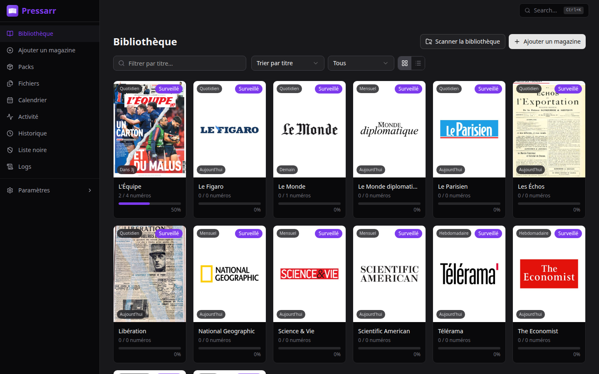
</p>

---

## ✨ Features

<table>
<tr>
<td width="33%" valign="top">

### 📚 Magazine Library
**Full collection management**
- Search & add magazines, with their cover
- ISSN-first metadata cascade
- Completion statistics
- Quality profile per title
- Issue groups (weekend, special editions)
- File renaming templates

</td>
<td width="33%" valign="top">

### 🔮 Calendar Forecast
**Predict future issues**
- Frequency-based predictions
- Visual calendar (grid & agenda)
- Confirmed vs predicted issues
- Delayed issue detection
- Wanted backlog on add

</td>
<td width="33%" valign="top">

### 🔍 Search & Download
**Automated pipeline**
- Prowlarr integration (magnet-only indexers too)
- Wanted-issue search on a schedule
- Multi-format queries (number, date)
- Scoring + optional auto-grab
- RSS sync every 30 min

</td>
</tr>
</table>

### 📂 Smart Import Pipeline
- Filename parsing (multilingual: FR/EN/DE/ES/IT, ordinals, `DD-MM-YYYY` dates)
- Title and date checks that refuse a file from another magazine or another day
- Routing by date: a file lands on the issue it really is, not only the one that was searched
- Quality detection (TruePDF, Retail, Scan…), renaming, cover extraction from the PDF
- **Packs**: grab a multi-issue pack and dispatch each file to its magazine and issue

### 📊 Activity & History
- **Activity** page: every search, grab, download, import and AI run, live, with its steps
- Download progress for torrents, Usenet and JDownloader
- Per-issue **technical sheet**: where the file came from and the full workflow timeline
- History, blocklist and logs

### 🏗️ Metadata Sources
- **Wikidata**, **BnF**, **ZDB**, **ISSN Portal** — authority data, logos, frequency, publisher
- **Google Books** — fallback covers and descriptions
- **Internet Archive** — Magazine Rack search & direct download
- **Anna's Archive** — additional source (optional)

### 📥 Download Clients
- **Torrent** — qBittorrent, Deluge, Transmission
- **Usenet** — SABnzbd, NZBGet
- **Direct** — Internet Archive (no client needed)
- **Hosters** — JDownloader 2, for the scene indexers *(experimental)*

### 🔔 Notifications
Receive alerts on grab, download, import, and errors:
- **Discord** — Webhook with cover art
- **Gotify** — Self-hosted push
- **Telegram** — Bot messages
- **Webhook** — Generic HTTP endpoint

### 🎨 Modern Web UI
- 🌐 English and French
- 🌙 Dark theme (native)
- 📱 Responsive design
- ⚡ Real-time progress via WebSocket

---

## 🧪 Experimental Features

These ship in the image but are off by default. Both are flagged **Experimental** in Settings.

### 🤖 AI (Ollama) — experimental, working

A local LLM, through [Ollama](https://ollama.com), helps where the filename is not enough:

- **Metadata enrichment** — reads the release name (text model) and the cover (vision model, plus Python OCR) to find the issue number and date, then an arbiter merges both with the parser's result.
- **Release ranking** — scores search results before a grab; it can only advise, veto the top result, or decide (`ai_advisory`, `ai_veto_only`, `ai_wins`).
- Everything stays on your server. Each run is kept with its steps (and optionally the cover crops it read), so you can see why it decided what it did.

It works, but its settings and behaviour may still change. Check what it decides on your first imports. A GPU with 8 GB of VRAM runs the default models (`mistral:7b`, `minicpm-v:8b`).

### 🏴 Scene indexers & JDownloader — experimental, not validated

**Bookys** and **telecharger-magazines.org** list French magazines and newspapers hosted on file hosters. Pressarr reads them through **FlareSolverr** (they sit behind Cloudflare), sends the chosen mirror to **JDownloader 2**, follows the download like a torrent and imports the file.

> [!CAUTION]
> **Not validated.** Searching works, but downloads mostly fail today: the free mirrors (nitroflare, upfiles, fileroy…) ask for a captcha or have no JDownloader plugin. Without a premium or debrid account set up in JDownloader, most grabs end without a file. Pressarr tries each mirror in turn and tells you why each one failed. The sites also change often.

---

## 🏃 Quick Start

### Docker Compose (Recommended)

```yaml
services:
  pressarr:
    image: sharkhunterr/pressarr:latest
    container_name: pressarr
    ports:
      - "8585:8585"
    volumes:
      - ./config:/config
      - ./magazines:/magazines
      - ./downloads:/downloads
    environment:
      - TZ=Europe/Paris
      - PUID=1000
      - PGID=1000
    restart: unless-stopped
    healthcheck:
      test: ["CMD", "python3", "-c", "import urllib.request; urllib.request.urlopen('http://localhost:8585/api/v1/system/status', timeout=5)"]
      interval: 30s
      timeout: 10s
      retries: 3
```

```bash
docker compose up -d
```

**Access**: http://localhost:8585

### Docker Run

```bash
docker run -d \
  --name pressarr \
  -p 8585:8585 \
  -v $(pwd)/config:/config \
  -v $(pwd)/magazines:/magazines \
  -v $(pwd)/downloads:/downloads \
  -e TZ=Europe/Paris \
  -e PUID=1000 -e PGID=1000 \
  sharkhunterr/pressarr:latest
```

---

## 🔧 Configuration

### Environment Variables

All settings can be overridden with `PRESSARR__` prefixed environment variables.

| Variable | Default | Description |
|----------|---------|-------------|
| `PRESSARR__PORT` | `8585` | Server port |
| `PRESSARR__LOG_LEVEL` | `info` | Log level (debug, info, warning, error) |
| `PRESSARR__DB_PATH` | `/config/pressarr.db` | SQLite database path |
| `PRESSARR__CONFIG_PATH` | `/config/pressarr.yml` | YAML config file path |
| `TZ` | `UTC` | Container timezone |
| `PUID` / `PGID` | root | User and group Pressarr runs as (see below) |
| `UMASK` | — | Umask of the files Pressarr writes, e.g. `002` |

### First Launch

1. **Add Root Folder** — Settings → Root Folders → point to your `/magazines` volume
2. **Connect Prowlarr** — Settings → Indexers → add your Prowlarr URL & API key
3. **Add Download Client** — Settings → Download Clients → configure qBittorrent, SABnzbd, etc.
4. **Add a Magazine** — Search for a title, pick a quality profile, and start monitoring
5. **Sit back** — Pressarr will automatically search, download, rename, and organize

---

## 🎯 Service Setup

### Prowlarr (Indexers)
Search for magazine releases across all your configured indexers.

1. Open Prowlarr → Settings → General
2. Copy the **API Key**
3. In Pressarr: Settings → Indexers → Add → enter URL & API key

### Download Clients
Send grabs to your preferred download client.

| Client | Protocol | Default Port |
|--------|----------|-------------|
| qBittorrent | Torrent | 8080 |
| Deluge | Torrent | 8112 |
| Transmission | Torrent | 9091 |
| SABnzbd | Usenet | 8080 |
| NZBGet | Usenet | 6789 |

### Internet Archive
Direct downloads from the Magazine Rack collection — no download client required.

1. Settings → Metadata → Enable Internet Archive
2. Pressarr searches & downloads directly via HTTP

### Google Books (Optional)
Enriches magazine metadata with cover art, descriptions, and publisher info.

1. Get an API key from [Google Cloud Console](https://console.cloud.google.com)
2. Settings → Metadata → enter Google Books API Key

### AI with Ollama (Optional, experimental)

1. Run [Ollama](https://ollama.com) and pull the models: `ollama pull mistral:7b` and `ollama pull minicpm-v:8b`
2. Settings → AI → enter the Ollama URL, then **Test the connection**: the model lists fill in
3. Turn on metadata enrichment and/or the release ranker

### Scene indexers + JDownloader (Optional, experimental)

```yaml
services:
  flaresolverr:
    image: ghcr.io/flaresolverr/flaresolverr:latest
    restart: unless-stopped

  jdownloader:
    image: jlesage/jdownloader-2:latest
    ports:
      - "5800:5800"          # JDownloader's web interface
    volumes:
      - ./jdownloader:/config
      - ./jdownloader/folderwatch:/config/folderwatch
      - ./downloads/jdownloader:/output
    restart: unless-stopped

  pressarr:
    volumes:
      - ./jdownloader/folderwatch:/folderwatch
      - ./downloads/jdownloader:/downloads/jdownloader
```

1. **FlareSolverr** — Settings → Indexers → *Magazine pipeline* → Endpoint URL `http://flaresolverr:8191/v1`
2. **Bookys / tm.org** — turn them on and **Test**. No account needed.
3. **JDownloader** — install the *Folder Watch* extension (Settings → Extension Modules), then in Pressarr:
   - *Folder watch path*: `/folderwatch` — Pressarr drops one `.crawljob` per grab there
   - *Output path*: `/downloads/jdownloader` — where Pressarr picks the finished files up
   - in `pressarr.yml`, `download_clients.jdownloader.output_path_in_jd2: /output` — the same folder as JDownloader sees it
4. **Follow downloads** — in JDownloader, Settings → Advanced Settings → `RemoteAPI`: turn on `DeprecatedApiEnabled`, turn off `DeprecatedApiLocalhostOnly`, restart it. Then set *API URL* to `http://jdownloader:3128`. Pressarr then shows each download's progress in Activity, moves on to the next mirror when one fails, and imports the file once it is done.
5. **Captchas** — set JDownloader's captcha mode to *skip* (Settings → Advanced → `CaptchaSettings`) so a mirror that needs one fails at once and the next is tried. A premium or debrid account in JDownloader is what makes these downloads work.

---

## 🗂️ Quality Profiles

Define which release qualities to accept and when to stop upgrading:

| Quality | Description |
|---------|-------------|
| TruePDF | Original digital PDF (best) |
| Retail | Commercial digital release |
| PDF (HQ) | High quality scan or conversion |
| PDF (LQ) | Low quality scan |
| Scan | Raw page scans |
| Unknown | Undetected quality |

Set a **cutoff** quality — Pressarr stops searching once that quality is reached, and auto-upgrades if a better quality appears.

---

## 🏗️ Architecture

```mermaid
flowchart TB
    subgraph UI["🖥️ Web Interface"]
        REACT[React 18 + TypeScript]
    end

    subgraph Backend["⚙️ FastAPI Backend :8585"]
        API[REST API<br/>/api/v1/*]
        WS[WebSocket<br/>Real-time updates]
        SCHED[APScheduler<br/>RSS Sync · Wanted Search · Download Check]
        PARSER[Filename Parser<br/>Multilingual]
        IMPORT[Import Pipeline<br/>Rename · Move · Organize]
    end

    subgraph Data["💾 Data Layer"]
        DB[(SQLite)]
        FS[File System<br/>/magazines]
    end

    subgraph Indexers["🔍 Indexers"]
        PROWLARR[Prowlarr]
    end

    subgraph Clients["📥 Download Clients"]
        QBIT[qBittorrent]
        DELUGE[Deluge]
        TRANS[Transmission]
        SAB[SABnzbd]
        NZB[NZBGet]
    end

    subgraph Meta["📖 Metadata"]
        CASCADE[Wikidata · BnF · ZDB · ISSN Portal]
        GBOOKS[Google Books]
        IA[Internet Archive]
    end

    subgraph Scene["🏴 Scene (experimental)"]
        FLARE[FlareSolverr]
        BOOKYS[Bookys · tm.org]
        JD2[JDownloader 2]
    end

    subgraph AI["🤖 AI (experimental)"]
        OLLAMA[Ollama]
    end

    subgraph Notif["🔔 Notifications"]
        DISCORD[Discord]
        GOTIFY[Gotify]
        TELEGRAM[Telegram]
        WEBHOOK[Webhook]
    end

    REACT -->|HTTP + WS| API
    REACT -->|Real-time| WS

    API --> DB
    SCHED --> API
    API --> PARSER
    API --> IMPORT
    IMPORT --> FS

    API -->|Search| PROWLARR
    API -->|Grab| QBIT & DELUGE & TRANS & SAB & NZB
    API -->|Fetch metadata| CASCADE & GBOOKS & IA
    API -->|Scrape| FLARE --> BOOKYS
    API -->|.crawljob + local API| JD2
    API -->|Enrich · rank| OLLAMA
    API -->|Alerts| DISCORD & GOTIFY & TELEGRAM & WEBHOOK
```

### Download & Import Flow

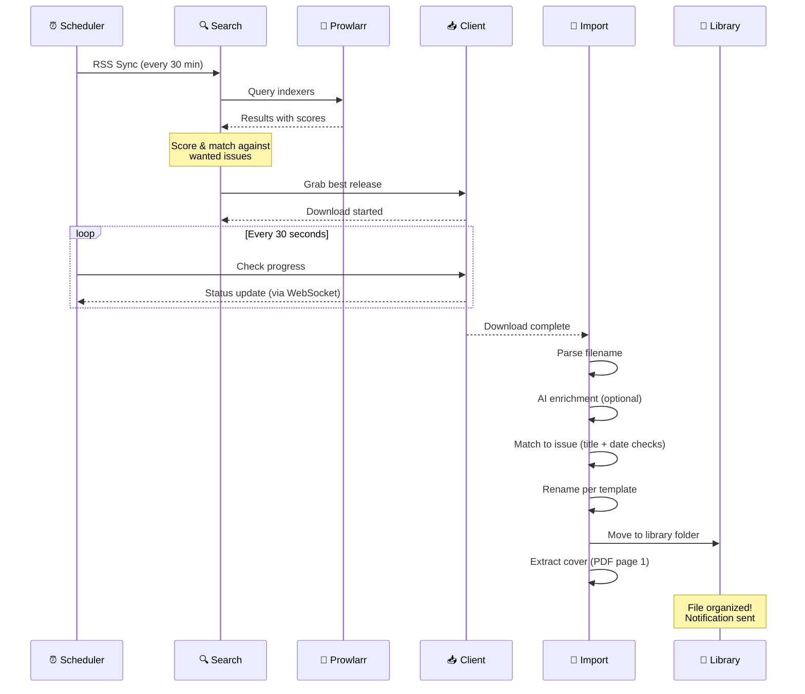

---

## 📸 Screenshots

> Screenshots use the French interface: Pressarr targets French press first, and some newer screens are not translated yet.

<details open>
<summary><b>📚 Library & Magazine Detail</b></summary>

| Magazine Library | Magazine Detail |
|------------------|-----------------|
|  | 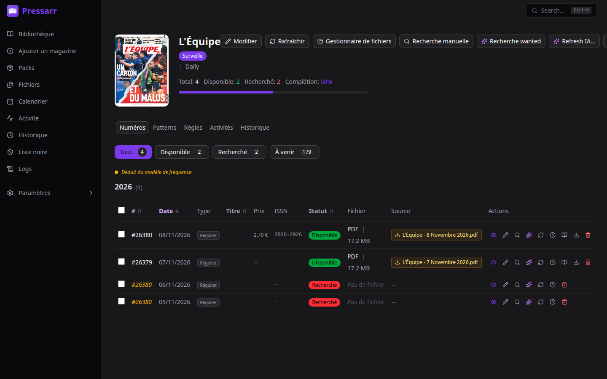 |

</details>

<details open>
<summary><b>➕ Adding & Searching</b></summary>

| Add a Magazine | Manual Search (Bookys tab) |
|----------------|----------------------------|
| 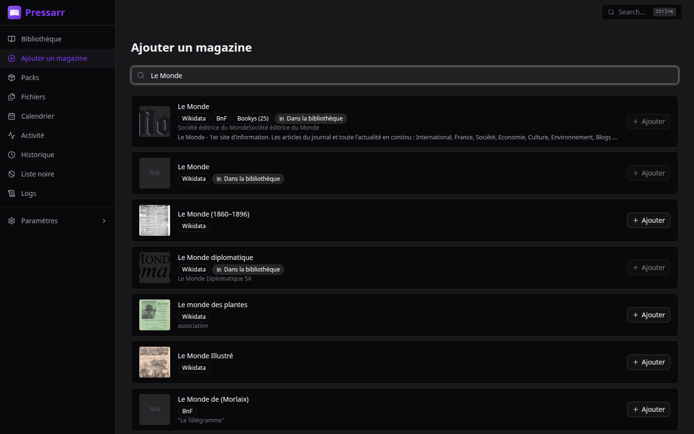 | 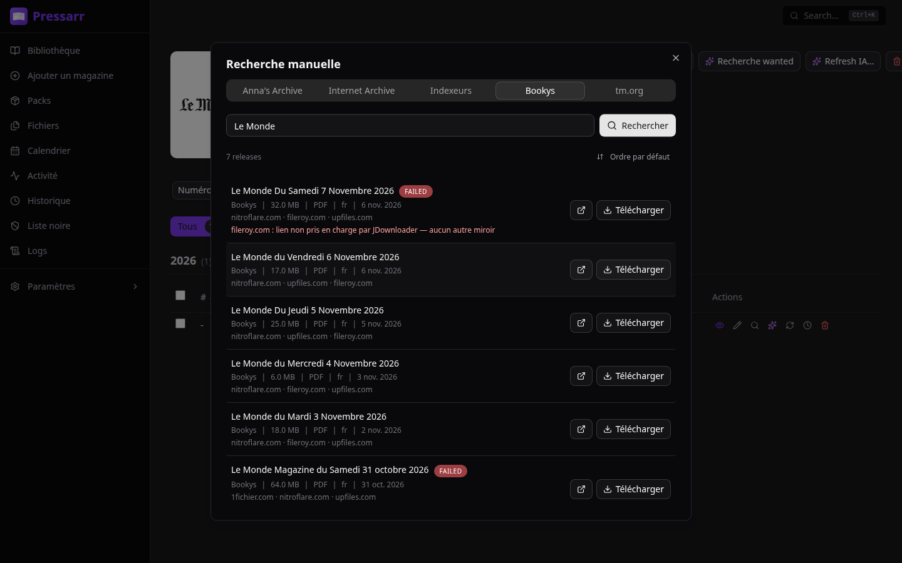 |

</details>

<details open>
<summary><b>🔮 Calendar & Activity</b></summary>

| Calendar Forecast | Activity |
|-------------------|----------|
| 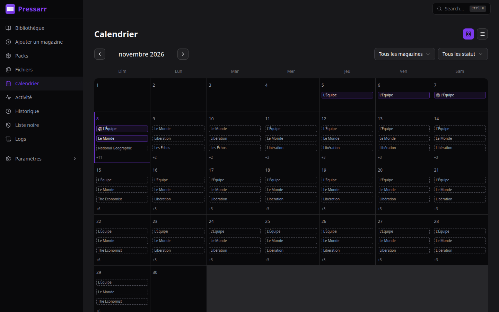 | 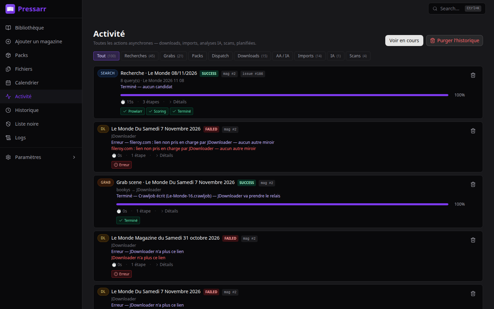 |

</details>

<details>
<summary><b>🧾 Issue Technical Sheet</b></summary>

Where the file came from, and every step from the search to the import.

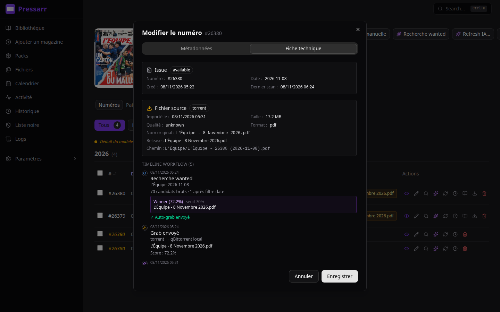

</details>

<details>
<summary><b>🧪 Experimental Settings</b></summary>

| AI (Ollama) | Bookys |
|-------------|--------|
| 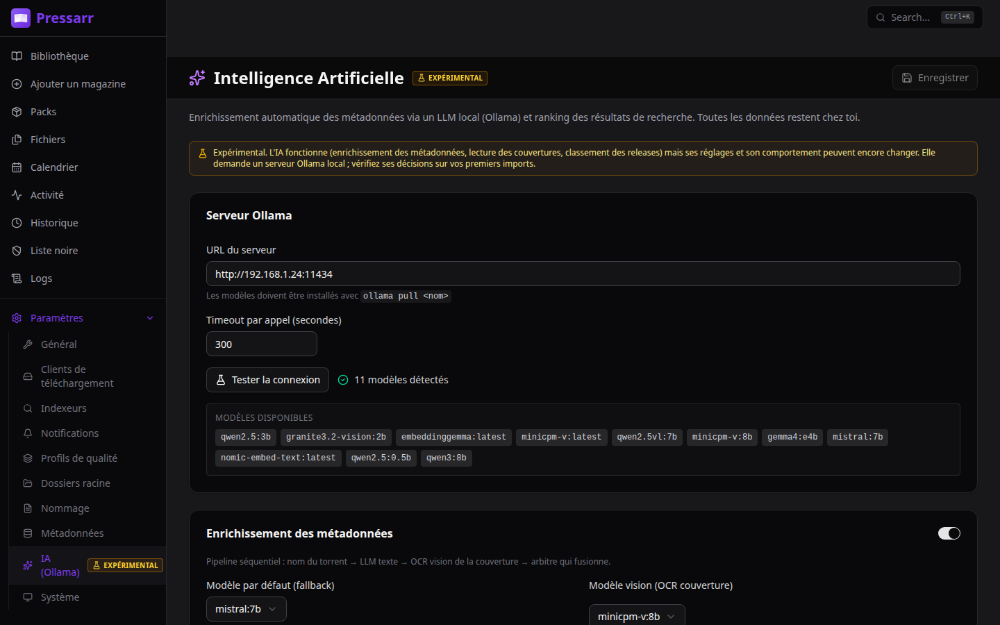 | 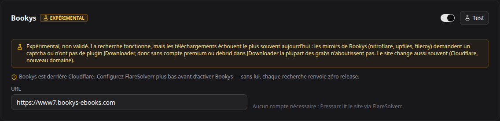 |

</details>

<details>
<summary><b>📱 Mobile</b></summary>


</details>

---

## 🌐 Multi-Language Support

Pressarr's UI speaks **2 languages**:

🇬🇧 English • 🇫🇷 Français

Some newer screens (AI settings, parts of the magazine page) are still French only.

The filename parser additionally supports month names in **5 languages** (EN, FR, DE, ES, IT) for accurate release detection.

Change language anytime from Settings → General (kept in each browser; by default, the browser's own language when Pressarr speaks it).

---

## 🛠️ Technology Stack

| Layer | Technologies |
|-------|--------------|
| **Backend** | Python 3.12 • FastAPI • SQLAlchemy 2.0 async • Alembic • APScheduler • PyMuPDF |
| **Frontend** | React 18 • TypeScript 5 • Tailwind CSS • Vite • shadcn/ui • TanStack Query |
| **Data** | SQLite (aiosqlite) • WebSocket real-time |
| **AI** | Ollama (text + vision models) • EasyOCR / RapidOCR |
| **DevOps** | Docker (multi-stage) • Health checks • PUID/PGID |

---

## 📦 Data & Volumes

### Docker Volumes

| Path | Content |
|------|---------|
| `/config` | Database, YAML config, API key |
| `/magazines` | Organized magazine library |
| `/downloads` | Temporary download directory |

### Running as a user (PUID/PGID)

Set `PUID` and `PGID` to your own UID/GID (`id -u` / `id -g`) — needed on most NAS and CIFS/NFS mounts:

```yaml
services:
  pressarr:
    image: sharkhunterr/pressarr:latest
    environment:
      - PUID=1000
      - PGID=1000
      - UMASK=002   # optional
```

At start, the container takes `/config` over for that user, then runs Pressarr as that user. `/magazines` and `/downloads` are left as they are (they can be large or on a network share): the log warns when that user cannot write to them, in which case:

```bash
sudo chown -R 1000:1000 ./magazines ./downloads
```

Without `PUID` / `PGID`, Pressarr runs as root, as before. Compose's `user: "1000:1000"` (or `docker run --user`) also works; Pressarr then cannot take `/config` over, so all three volumes must already be writable by that user.

Your download client must write to `/downloads` with a UID/GID Pressarr can read, so that imports can move the files.

### Configuration File

Pressarr uses a YAML config file at `/config/pressarr.yml` for persistent settings. All values can be overridden by environment variables with the `PRESSARR__` prefix.

---

## 🧑‍💻 Development

### Prerequisites
- Python 3.12+
- Node.js 20+
- npm 10+

### Backend

```bash
cd backend
python3.12 -m venv .venv
source .venv/bin/activate
pip install -r requirements.txt
uvicorn app.main:app --reload --host 0.0.0.0 --port 8585
```

### Frontend

```bash
cd frontend
npm install
npm run dev
```

### Tests

```bash
cd backend
pytest tests/ -v --asyncio-mode=auto
```

### API Documentation

Once running, access the auto-generated API docs at:
- **Swagger UI**: http://localhost:8585/api/docs
- **ReDoc**: http://localhost:8585/api/redoc

---

## 🤝 Contributing

Contributions welcome! Please:

1. Fork the repository
2. Create a feature branch
3. Run linting: `ruff check .` (backend) and `npm run lint` (frontend)
4. Submit a pull request

---

## 🙏 Acknowledgments

**The Need**: Self-hosted media enthusiasts have Sonarr for TV, Radarr for movies, Lidarr for music — but nothing for magazines. Pressarr fills that gap, bringing automated magazine management to the *arr ecosystem.

**The Approach**: Built entirely through [Claude Code](https://claude.ai/code) using AI-assisted development. From database schema to responsive UI, every line was crafted through conversation.

Special thanks to the *arr community and all the homelab enthusiasts who inspired this project!

---

## 📄 License

MIT License — see [LICENSE](LICENSE) file for details.

---

<div align="center">

**Built with Claude Code 🤖 for the *arr community 📚**

[⭐ Star on GitHub](https://github.com/sharkhunterr/pressarr) • [🐛 Report Bug](https://github.com/sharkhunterr/pressarr/issues) • [💡 Request Feature](https://github.com/sharkhunterr/pressarr/issues)

</div>
